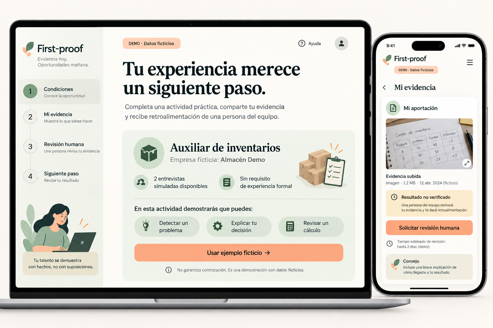
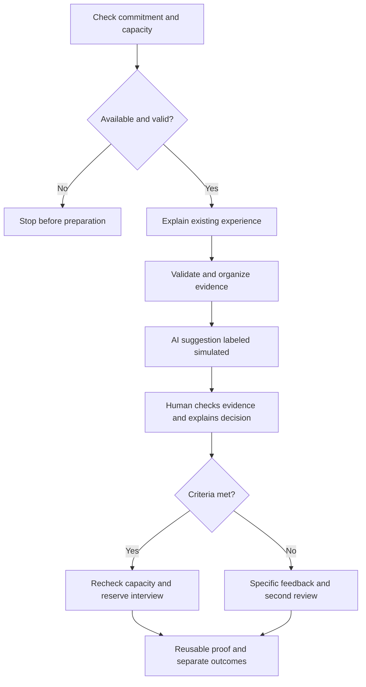
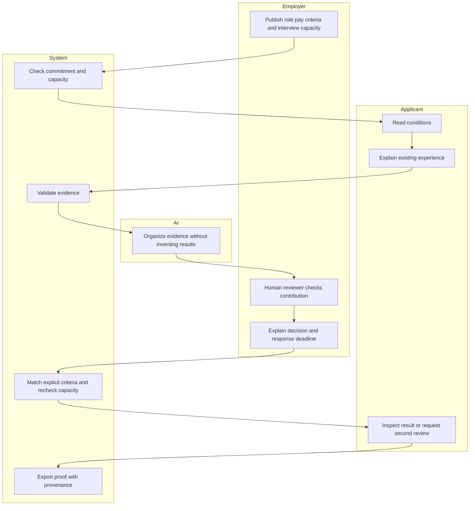

# First-proof | Week 9 Build Packet
Isabella Zevada | 8 October 2026 | Packet created before application code

## Problem in my words
I can explain what I learned in university projects, but that does not help if nobody opens the door to review it. A polished portfolio alone would not solve the access problem I experienced. First-proof tests whether existing evidence, clear criteria and employer commitments can create a concrete next step without another cycle of unpaid tests.

## Exact user
A young person in Mexico seeking a first inventory or operations opportunity, with university or informal experience, a phone and limited time. The synthetic demo user is Valeria, 21, who organized stock in a family shop and has no professional portfolio. This is a research hypothesis, not an interviewed person.

## Success before the module closes
The live demo lets a visitor check a fictional employer commitment, prepare an existing-example evidence card, inspect a clearly labeled simulated AI suggestion, perform a simulated human review, and generate a reusable proof card with either a simulated interview or a specific explanation. The same flow blocks preparation when there is no commitment or capacity. This demonstrates software behavior, not actual recruitment outcomes.

## Mockup

Generated before application implementation. Final interface may differ. All opportunities and commitments shown are fictional.

## Flowchart

## Swimlane

## Benchmark line
The strongest benchmark I selected for this slice is Forage, which provides free employer-designed job simulations; this is a design judgment, not a measured worldwide ranking.
Mine localizes the experience for Mexico by starting from existing university or informal evidence and requiring a committed review-to-interview path before preparation, instead of making another simulation the entry requirement.
Sources checked 8 October 2026: https://www.theforage.com/ ; https://mexico.generation.org/empleadores/ . Generation Mexico's employer partnerships inform the commitment model; neither source establishes that First-proof already has partners.

## Long view: three years
First-proof could become a portable record of demonstrated skills and documented contributions that applicants share selectively with participating employers. Employers would commit capacity, criteria, pay and response deadlines before recruitment, while independent reviewers audit whether interviews become offers or paid opportunities. Growth would depend on reduced repeat testing and credible work transitions, rather than badges, uploaded files or interview counts alone.

## Blueprint conditions and shadow
- Recruit only after verified commitments for actual vacancies; demo commitments remain fictional.
- Limit preparation to existing evidence and a maximum of two hours; one announced 15-minute conversation.
- New work usable by a company requires a separate payment agreement; pause the review if requested.
- Evaluate university and informal experience using the same criteria; omit school prestige and contacts.
- Publish place allocation beforehand. This slice covers one fictional admitted applicant; production must allocate scarce pilot places by an auditable lottery among eligible applicants before preparation.
- Accept a plain explanation without a professional report. Missing documentation means an unverified result, not automatically a missing skill.
- AI advises; a person gives reasons and a second review is available.
- Track reviews, interviews, offers, paid opportunities and repeated tests separately. Five interviews with no offers show initial access and require rejection analysis before repeating the pilot.
- The shadow is keeping someone busy proving they can work without an opportunity. Stop if commitments are symbolic, the experience barrier returns, or preparation continues without progress.

## Scope cut
No CV builder, job board, hiring guarantee, autonomous hiring score, real applicants, real employer database, actual appointments, commercial work submission, uploaded files or persistent personal records. Voice and real-employer onboarding are deferred. Human review controls are explicitly a role-play in the demo, not secure production authorization.

## Architecture and stack
| Layer | Implementation | Verification boundary |
|---|---|---|
| Interface | Buildless HTML/CSS/JavaScript; Spanish; responsive | Mechanical checks; browser QA if supported |
| LLM component | Clearly labeled simulated suggestion plus versioned production prompt | No live LLM connection; cannot claim a live Dragon Stack |
| Structured data | Fictional JSON commitment, criteria, evidence provenance | Schema and consistency checks; no real employer verification |
| Third component | Deterministic matching and capacity state machine | Automated transition tests |
| Hosting | Sites static deployment | Native deployment result |
| Data | Memory only; user-triggered local export | No server, database, cookies or browser persistence |

The prototype is free and uses no paid API. A live LLM connection remains necessary if the instructor requires actual inference rather than the expressly labeled simulated outputs allowed in the assignment. Do not conceal this limitation.

## Security floor
No API keys or secrets in source. No personal records are stored, so Supabase Auth and RLS are not applicable to this fictional memory-only demo; production storage requires Google sign-in and per-user RLS before real data is accepted. All fields have type and length checks, inputs render as text, and every export repeats the fictional-data and simulated-AI notices. The demo warns against personal information and accepts only demo evidence. No real Novafoods figures or names are seeded.

## Test plan
1. Valid evidence reaches human review and creates a simulated interview only after all criteria and capacity checks pass.
2. Missing commitment, zero capacity, expired commitment, or formal experience requirement blocks preparation.
3. Whitespace-only, excessively long, invalid numeric and invalid evidence-type inputs are rejected.
4. Unsupported result remains unverified even if the skill criteria pass.
5. AI cannot reserve an interview; the human role-play is required.
6. Recheck changed capacity between preparation and decision; never decrement below zero or reserve twice.
7. Company request for unpaid usable work pauses the flow.
8. Second review preserves evidence and records a separate reason; exports remain labeled fictional.
9. Record an actually observed defect, fix it and redeploy; retain test output and both deployment IDs.
10. Fresh-chat persona pass with screenshots in order is pending until screenshots and an independent synthetic session are available. Do not replace it with invented results.
